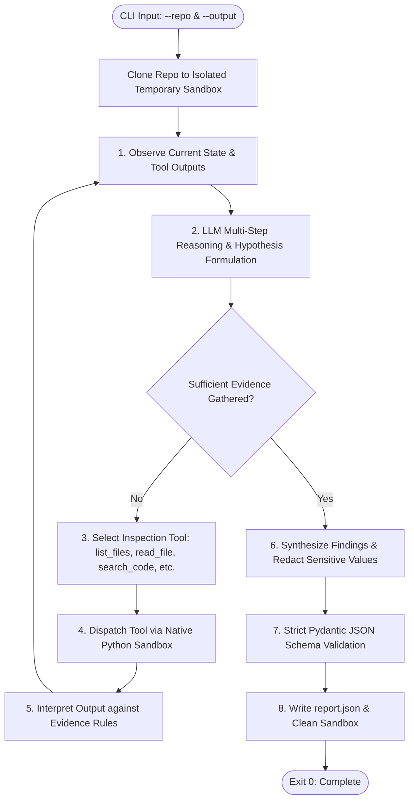

# Autonomous DevOps Repository Auditing Agent

[](https://www.python.org/downloads/)
[](https://github.com/astral-sh/ruff)
[](https://docs.pytest.org/)
[](LICENSE)

An autonomous AI agent engineered in native Python that inspects GitHub repositories, identifies real-world DevOps, CI/CD, and security violations across **9 standard engineering domains**, and produces verified, evidence-backed machine-readable JSON audit reports.

Built from first principles without prebuilt orchestration frameworks (such as LangChain or LangGraph), featuring an explicit **Observe → Reason → Select Tool → Execute Tool → Interpret Results → Report** reasoning cycle with strict false-positive mitigation.

---

## 🎯 Architecture & Agent Cycle

The agent implements an explicit, non-destructive **ReAct (Reasoning + Acting)** loop. It investigates an unfamiliar repository autonomously—starting from directory discovery, traversing build and CI configurations, executing lint/test checks, searching for leaked secrets, and validating findings before generating structured output.



### Prohibited Framework Compliance
In strict compliance with assignment constraints:
- **No Orchestration Frameworks**: Built without LangChain, LangGraph, AutoGen, CrewAI, or n8n.
- **Pure Python Dispatch**: Agent control flow, tool execution dispatch, token-safe buffer management, and context histories are implemented entirely in Python.
- **Supported Provider SDKs**: Uses standard basic LLM provider SDKs (`google-genai` and `openai`), allowing seamless switching between **Google Gemini (free)**, **Groq (free)**, and **OpenAI**.

---

## 🔍 DevOps Inspection Domains & Rules Catalog

The agent systematically audits repositories across **9 DevOps engineering domains**:

| Category | Rule ID | Scope & Detected Violations |
| :--- | :--- | :--- |
| **Repository Hygiene** | `HYG-001` - `HYG-003` | Missing README, unsuitable/missing `.gitignore`, tracked generated or cache artifacts (`.DS_Store`, `__pycache__`, `*.pyc`, `build/`). |
| **Dependency Management** | `DEP-001` - `DEP-003` | Absent required lockfiles (`poetry.lock`, `package-lock.json`, `Pipfile.lock`), unpinned dependencies (`flask` without bounds), conflicting dependency declarations. |
| **Code Quality** | `QUAL-001` - `QUAL-002` | Absence of linter/formatter configurations (Ruff, Flake8, Black, ESLint), obvious code maintainability hazards. |
| **Testing** | `TEST-001` - `TEST-003` | Complete absence of automated tests, tests present but omitted from CI pipelines, broken test configurations. |
| **GitHub Actions / CI** | `CI-001` - `CI-004` | Missing CI triggers on PRs/pushes, ineffective gates (`continue-on-error: true` on critical checks), insecure `pull_request_target` checkouts. |
| **Security** | `SEC-001` - `SEC-003` | Exposed hardcoded credentials (API tokens, private keys), overly permissive workflow tokens (`permissions: write-all`), unsafe script execution. |
| **Configuration** | `CONF-001` - `CONF-003` | Machine-specific absolute paths (`/home/user/...`, `C:\...`), committed local `.env` files, missing `.env.example` templates. |
| **Collaboration** | `COL-001` - `COL-002` | Missing contribution guide / PR templates in team repositories, insecure PR auto-merges without reviews. |
| **Build & Release** | `BLD-001` - `BLD-002` | Missing build verification for deployables, risky release automation without git tags or gate approvals. |

---

## 🛡️ False-Positive Mitigation & Evidence Rules

A primary grading criterion is detection **Precision and Recall**. To prevent false positives on healthy or modern repositories, the agent enforces built-in evidence heuristics:

1. **Equivalence Rule**: The absence of a specific legacy file is **not** a defect if a modern standard alternative is present:
   - If `pyproject.toml` is used for dependencies and tools, missing `requirements.txt`, `setup.py`, or `.flake8` is **not** flagged.
   - If `ruff` is configured, missing `black`, `isort`, or `flake8` is **not** flagged.
   - If GitHub Actions is present, missing CircleCI/Travis is **not** flagged.
2. **Remote Branch Protection Rule**: Remote branch rulesets (e.g. required reviewers, signed commits) cannot be deduced from repository files alone and are never guessed without concrete configuration evidence.
3. **Secret Redaction Rule**: Plaintext credentials, tokens, or passwords are **never reproduced** in `evidence` or `description`. They are automatically masked with `***REDACTED***` patterns.
4. **Sandboxed Isolation**: Targets are cloned into ephemeral temporary directories (`tempfile.TemporaryDirectory`) and left completely unchanged.

---

## 🚀 Quickstart & Setup Guide

### 1. Prerequisites
- Python 3.10, 3.11, 3.12, 3.13, or 3.14
- Git installed on your system

### 2. Clone and Setup Environment
```bash
# Clone this repository
git clone https://github.com/Shayan6t/devops-auditing-agent.git
cd devops-auditing-agent

# Create and activate virtual environment
python3 -m venv .venv
source .venv/bin/activate  # On Windows: .venv\Scripts\activate

# Install dependencies
pip install --upgrade pip
pip install -r requirements.txt
```

### 3. Configure API Key
Copy the template configuration file:
```bash
cp .env.example .env
```

Open `.env` in any text editor and supply your API key:
- **Google Gemini (Recommended & 100% Free)**:
  1. Navigate to [Google AI Studio](https://aistudio.google.com/).
  2. Sign in with your Google Account and click **"Get API key"** -> **"Create API key"**.
  3. Paste your key in `.env`:
     ```env
     LLM_PROVIDER=gemini
     GEMINI_API_KEY=AIzaSy...your_actual_key_here...
     GEMINI_MODEL=gemini-2.5-flash
     ```

*(Alternative providers such as Groq or OpenAI are also supported by setting `LLM_PROVIDER=groq` or `LLM_PROVIDER=openai`.)*

---

## 💻 Execution Interface

The agent runs unattended without interactive prompts according to the exact course contract:

```bash
python agent.py --repo <github_repository_url_or_local_path> --output report.json
```

### Example Usage:
```bash
# Audit a remote public GitHub repository:
python agent.py --repo https://github.com/pallets/flask --output flask_audit.json

# Audit a local repository directory:
python agent.py --repo ./tests/fixtures/sample_repo --output local_audit.json
```

### CLI Arguments:
| Argument | Required | Default | Description |
| :--- | :---: | :---: | :--- |
| `--repo` | **Yes** | — | Target public GitHub URL or local repository path. |
| `--output` | **Yes** | — | Output file path for the generated JSON report. |
| `--provider` | No | Auto | Provider override: `gemini`, `groq`, or `openai`. |
| `--model` | No | Auto | Model identifier override (e.g. `gemini-2.5-flash`). |
| `--max-steps` | No | `15` | Maximum reasoning/tool execution steps. |
| `--quiet` | No | False | Suppress live step-by-step reasoning logs on stderr. |

---

## 📋 Output Contract Specification

The resulting report conforms strictly to the specified schema contract:

```json
{
  "repository": "https://github.com/example/demo-project",
  "violations": [
    {
      "rule_id": "SEC-001",
      "category": "security",
      "severity": "critical",
      "file": "config.py",
      "line": 17,
      "description": "Hardcoded API credential",
      "evidence": "Credential assigned directly in source code",
      "recommendation": "Use a secrets manager or environment variable"
    }
  ]
}
```

- **Severity Levels**: `critical`, `high`, `medium`, `low`.
- **Inapplicable Values**: Explicit JSON `null` for `file` or `line` when defects are repository-wide.
- **Safety**: Raw secrets are systematically redacted.

---

## 🧪 Automated Testing & Verification

The project includes unit and integration tests covering inspection tools, agent reasoning loops with mocked LLMs, schema validation, and secret masking:

```bash
# Run complete test suite
pytest -v

# Run code style & formatting checks
ruff check .
```

---

## 📁 Repository Structure

```
devops-auditing-agent/
├── agent.py                     # CLI entry point complying with execution contract
├── tools.py                     # Inspection tools (list_files, read_file, search_code, git_log, etc.)
├── core/
│   ├── __init__.py
│   ├── schemas.py               # Pydantic models, JSON contract validation, secret redactor
│   ├── prompts.py               # DevOps rules taxonomy, evidence guidelines, system prompt
│   ├── llm_client.py            # Universal multi-provider client (Gemini, Groq, OpenAI)
│   └── agent_loop.py            # Explicit Python ReAct loop (Observe -> Reason -> Tool -> Report)
├── tests/
│   ├── __init__.py
│   ├── test_tools.py            # Automated tests for inspection tools & path safety
│   └── test_agent.py            # Automated tests for agent loop, schemas, and redaction
├── sample_report.json           # Authentic sample audit report
├── .github/workflows/ci.yml     # Automated CI pipeline running tests and linter
├── requirements.txt             # Pinned production and test dependencies
├── pyproject.toml               # Modern Python packaging configuration
├── .env.example                 # Example environment variable template
├── .gitignore                   # Comprehensive ignores for caches, environments, and reports
└── README.md                    # Project documentation, architecture, and guides
```

---

## 🎓 Resume / Portfolio Highlights

This project demonstrates core competencies in:
- **Autonomous AI Agents & Tool Calling**: Building production-grade ReAct agent loops in pure Python without black-box framework abstractions.
- **DevOps & DevSecOps Domain Knowledge**: In-depth rulesets across GitHub Actions CI/CD security, least privilege token permissions, dependency supply chain management, and secret exposure risks.
- **Defensive Engineering**: Sandboxed execution, path traversal guards (`os.path.commonpath`), regex secret redacting, and false-positive elimination.
- **Modern Python Quality Standards**: Strict Pydantic v2 schemas, type annotations, Ruff static analysis, and automated Pytest suites.
